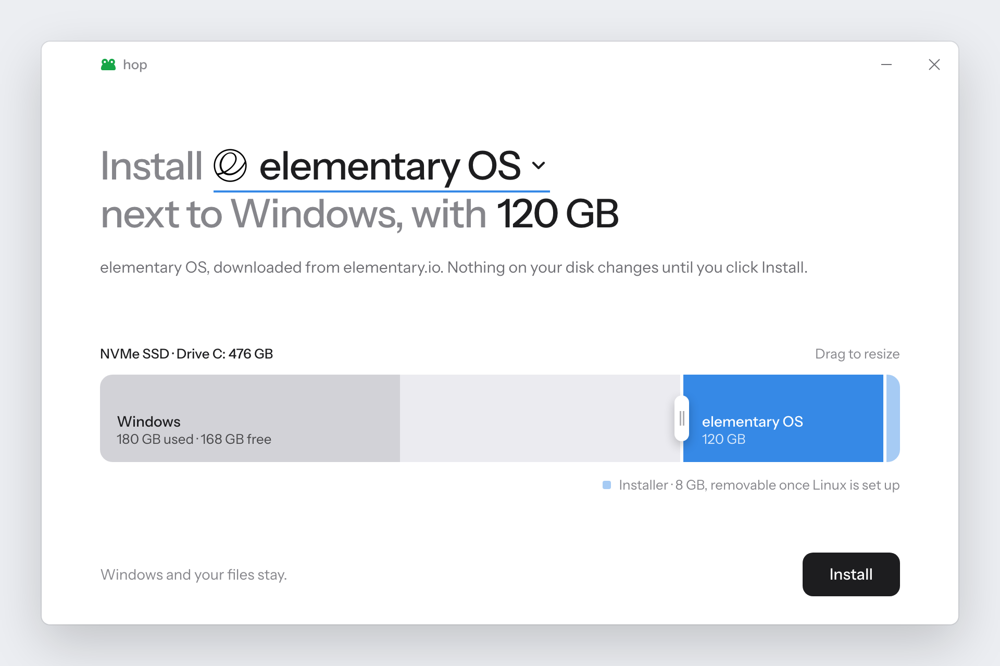

<p align="center">
  <picture>
    <source media="(prefers-color-scheme: dark)" srcset="assets/brand/hop-lockup-dark.svg">
    
  </picture>
</p>

<p align="center">Install Linux next to Windows without a USB stick.</p>

<p align="center">
  
</p>
<p align="center"><sub>A render of the main window, drawn to the app's layout. Not yet a capture from Windows.</sub></p>

## What it is

hop is a single Windows app that installs Linux alongside Windows. Pick a system, drag to choose how
much space it gets, and click Install. There's no USB stick to find and nothing to install first.

## What it does

- **Downloads from official sources.** It gets the ISO from the project's own server and verifies its
  checksum where the project publishes one. You can also use an ISO you already have.
- **Makes room safely.** It checks your PC first, and nothing on the disk changes until those checks pass.
- **Tells you what to click.** It lists the exact choices to make in the Linux installer.
- **Gets you unstuck.** If the PC goes back to Windows, reopening hop explains why and can restart into the BIOS.
- **Cleans up after itself.** Undo gives the space back to Windows, and it can also remove another Linux
  already on the drive.

**Systems:** elementary OS, Ubuntu and its flavours (Budgie, Xubuntu, Lubuntu, Cinnamon, Unity, Edubuntu,
Studio), Linux Mint and Pop!_OS. Other Ubuntu-based ISOs should work too. Kubuntu, Fedora and Arch aren't
supported.

**Needs:** Windows 10 (1803 or newer) or 11, on a UEFI PC with a GPT disk, which is nearly every PC sold with them.

## How it works

A USB installer is just a FAT32 drive with the ISO's files on it. hop makes the same thing on your
internal disk:

```
Before   [ EFI ][ C: Windows                              ][ Recovery ]
After    [ EFI ][ C: Windows       ][ Linux ][ Installer  ][ Recovery ]
```

1. **Download and check** the ISO, and confirm it's a system hop can install.
2. **Make room** after C:, using free space first and shrinking C: only if needed.
3. **Copy** the ISO's files onto a small FAT32 partition, and check each one.
4. **Add a startup entry** with the ISO's signed boot loader, for the next restart only.
5. **Restart.** The Linux installer opens and installs into the space hop made.

More detail is in [How hop works](docs/ARCHITECTURE.md).

## Use it

Download `hop.exe` from [Releases](../../releases) and run it. Windows asks for administrator access, and
SmartScreen may warn because hop isn't code-signed yet: click **More info → Run anyway**.

If something goes wrong, see [Troubleshooting](docs/TROUBLESHOOTING.md).

## Build it

You need the .NET SDK, on any OS. The result is `bin/Release/hop.exe`.

```
dotnet build -c Release
```

See [Contributing](CONTRIBUTING.md) to help, or to add a Linux system.

## License

[MIT](LICENSE). Instrument Sans is under the SIL Open Font License. Linux logos belong to their projects
and are listed in [SOURCES.md](assets/logos/SOURCES.md). hop isn't affiliated with any of them.
