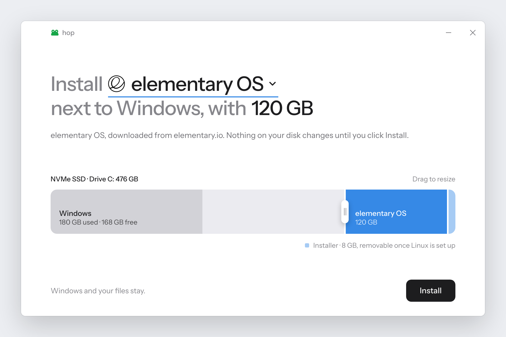
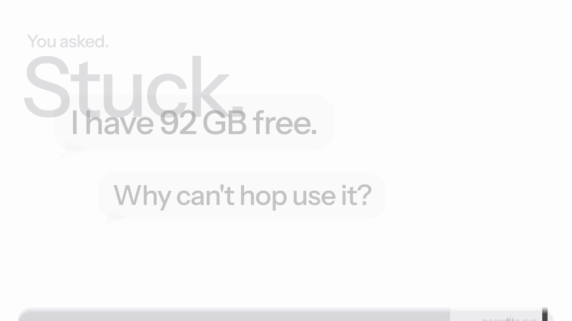

<p align="center">
  <picture>
    <source media="(prefers-color-scheme: dark)" srcset="assets/brand/hop-lockup-dark.svg">
    
  </picture>
</p>

<p align="center">Cài Linux bên cạnh Windows mà không cần USB.</p>

<p align="center">
  <a href="README.md">English</a> · <strong>Tiếng Việt</strong>
</p>

<p align="center">
  
</p>

## Đây là gì

hop là một ứng dụng Windows duy nhất giúp cài Linux song song với Windows. Chọn một hệ thống, chọn
một ổ đĩa, kéo để chọn dung lượng dành cho nó, rồi bấm Install. Không cần tìm USB, cũng không cần
cài gì trước.

## Nó làm được gì

- **Tải từ nguồn chính thức.** Nó lấy ISO từ máy chủ của chính dự án, hoặc từ mirror mà dự án hướng
  người dùng tới, và kiểm tra checksum ở những nơi dự án công bố checksum. Bạn cũng có thể dùng ISO
  mình đã có sẵn.
- **Dọn chỗ an toàn.** Nó kiểm tra PC của bạn trước, và không có gì trên đĩa thay đổi cho đến khi các
  bước kiểm tra đó đạt.
- **Giải phóng dung lượng bị kẹt.** Một ổ đĩa có thể còn trống nhiều mà vẫn từ chối thu nhỏ, vì có những
  file Windows không di chuyển được. Make room dọn chúng chỉ bằng một cú bấm và khôi phục lại cài đặt
  của bạn sau đó.
- **Đi đến nơi còn chỗ.** Thu nhỏ ổ C: hoặc một ổ khác, dùng vùng trống sẵn có, hoặc dùng ổ đĩa thứ hai
  trong PC. Nếu C: đầy, hop gợi ý một ổ chưa đầy, và file tải về cũng có thể để ở nơi khác.
- **Cho bạn biết phải bấm gì.** Nó liệt kê chính xác các lựa chọn cần thực hiện trong trình cài đặt Linux.
- **Giúp bạn thoát kẹt.** Nếu PC quay lại Windows, mở lại hop sẽ giải thích lý do và có thể khởi động
  lại vào BIOS.
- **Tự dọn dẹp sau khi xong.** Undo trả lại dung lượng cho ổ đĩa đã lấy, và nó cũng có thể gỡ một bản
  Linux khác đang có trên ổ.
- **Có thể thay thế Windows hoàn toàn, đối với những hệ thống hop đã thấy hoạt động:** Ubuntu, Xubuntu, Ubuntu Budgie, Ubuntu Cinnamon, Edubuntu, Ubuntu Studio, Zorin OS, Fedora Workstation, Ultramarine, elementary OS, Debian, Arch và Omarchy. Đây là một lựa chọn riêng với cảnh báo riêng, và bạn phải
  gõ ERASE. hop chỉ tạo trình cài đặt; trình này tự sao chép vào bộ nhớ để có thể xóa chính ổ đĩa nó
  khởi động từ đó khi bạn ra lệnh. Nó cần bộ nhớ lớn hơn kích thước của ISO, và chỉ được đề xuất cho
  những hệ thống hop đã thấy xóa đĩa và khởi động lại sau đó.

**Các hệ thống:** elementary OS, Ubuntu và các bản biến thể của nó (Budgie, Xubuntu, Cinnamon, Edubuntu,
Studio), Linux Mint, Pop!_OS, Zorin OS, Debian, Fedora Workstation, Ultramarine, CachyOS, Arch Linux và Omarchy.
Các ISO khác dựa trên Ubuntu cũng có thể dùng được, nếu bạn tự chọn file. Kubuntu không được hỗ
trợ, vì ISO của nó có một file quá lớn đối với FAT32. CachyOS, Arch, Omarchy và Pop!_OS cần tắt Secure Boot.
Omarchy cũng cần tắt BitLocker hoàn toàn trên ổ của nó, chứ không chỉ tạm dừng, và hop sẽ từ chối cho đến khi
điều đó được thực hiện. hop sẽ không tự tắt thay cho bạn.
Debian, CachyOS, Linux Mint và Zorin OS chưa thể cài lên ổ đĩa thứ hai, và Omarchy chỉ từ ISO 4.0 của chính bạn.
Lubuntu và Ubuntu Unity có trong danh sách nhưng hiện bị từ chối: trình cài đặt của chúng là một trình khác, và hop chưa thấy
chúng khởi động được sau đó.

**Yêu cầu:** Windows 10 (1803 trở lên) hoặc 11, trên PC dùng UEFI với đĩa GPT, tức là gần như mọi PC bán kèm
các hệ điều hành đó. Linux phải cài lên ổ đĩa trong PC, không phải ổ USB.

<p align="center">
  
</p>

## Cách hoạt động

Một USB cài đặt chẳng qua là một ổ FAT32 chứa các file của ISO. hop tạo ra đúng thứ đó trên
ổ đĩa trong của bạn:

```
Before   [ EFI ][ C: Windows                              ][ Recovery ]
After    [ EFI ][ C: Windows       ][ Installer ][ Linux  ][ Recovery ]
```

1. **Tải và kiểm tra** ISO, và xác nhận đó là hệ thống hop có thể cài.
2. **Dọn chỗ** phía sau ổ đĩa bạn chọn, dùng vùng trống sẵn có trước và chỉ thu nhỏ ổ khi cần.
3. **Sao chép** các file của ISO lên một phân vùng FAT32 nhỏ, và kiểm tra từng file.
4. **Thêm một mục khởi động** với boot loader đã ký của ISO, chỉ cho lần khởi động lại tiếp theo.
5. **Khởi động lại.** Trình cài đặt Linux mở ra và cài vào vùng trống hop đã dọn.

Chi tiết hơn có trong [Cách hop hoạt động](docs/ARCHITECTURE.md).

## Sử dụng

Tải `hop.exe` từ [Releases](../../releases) và chạy nó. Windows sẽ xin quyền quản trị viên, và
SmartScreen có thể cảnh báo vì hop chưa được ký số: bấm **More info → Run anyway**.

Nếu có gì trục trặc, xem [Khắc phục sự cố](docs/TROUBLESHOOTING.md).

## Tự build

Bạn cần .NET SDK, trên bất kỳ hệ điều hành nào. Kết quả là `bin/Release/hop.exe`.

```
dotnet build -c Release
```

Xem [Đóng góp](CONTRIBUTING.md) để giúp sức, hoặc để thêm một hệ thống Linux.

## Giấy phép

[MIT](LICENSE). Instrument Sans dùng giấy phép SIL Open Font License. Các logo Linux thuộc về dự án
của chúng và được liệt kê trong [SOURCES.md](assets/logos/SOURCES.md). hop không liên kết với bất kỳ dự án nào trong số đó.
